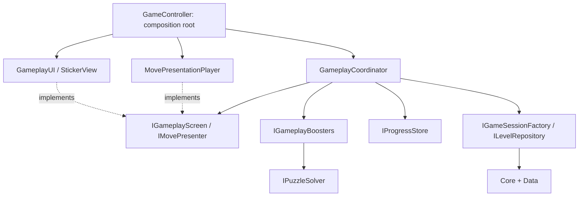

# Gameplay và artwork

## Tách trách nhiệm

`GameController` là composition root của scene, giữ serialized references và tạo/inject các dependency. Các hàm public cũ được giữ để scene và công cụ test vẫn gọi được. Nó không còn chứa luật chọn sticker, inventory, modal flow hoặc animation.

| Phần | Trách nhiệm | Có phụ thuộc UI không? |
|---|---|---|
| `Data` | ScriptableObject level/category/sticker/balance và alpha mask | Không |
| `Core` | Session runtime, thu thập/category/buffer, luật đặc biệt, geometry, solver | Không |
| `Gameplay/GameplayCoordinator` | Load/retry/next, nhận lệnh, điều phối presentation, win/fail/pause | Chỉ qua `IGameplayScreen`, `IMovePresenter` |
| `Gameplay/GameplayBoosters` | Quy tắc booster, solver và trừ inventory khi thành công | Không |
| `Services` | `IProgressStore` và triển khai PlayerPrefs, feedback interfaces | Không |
| `Presentation/MovePresentationPlayer` | Các chuyến bay đồng thời, commit theo thứ tự, animation khay | Có, adapter Unity |
| `Presentation/GameplayUI` | Tạo/cập nhật view, render HUD, hiển thị modal và phản hồi bấm sai | Có |
| `Presentation/StickerView` | Nhận Old Input PointerDown, alpha raycast và feedback của một sticker | Có; chỉ nhận read/input ports |
| `Presentation/GameAudioFeedback` | Adapter IGameFeedback, pool AudioSource, mute preference và tiếng bấm sai/UI | Có, adapter Unity |
| `Presentation/GameCelebration` | Nảy ô đích, tia sáng, confetti và coin trang trí; coroutine/layer độc lập | Có; không đổi model hoặc cộng coin |

Assembly definitions khóa chiều dependency: `Core → Data`; `Services → Core/Data`; `Gameplay → Core/Data/Services`; `Runtime` chứa composition root và presentation, tham chiếu các assembly trên cùng UGUI/TMP. `Gameplay` và `Core` không tham chiếu `StickyPeerSort.Runtime`, Canvas, UGUI hoặc TextMeshPro. Có test kiểm tra điều này và chạy `GameplayCoordinator` với presenter/screen/save giả, không tạo Canvas hoặc MonoBehaviour.

## Áp dụng SOLID

`SpecialStickerPresentation` là adapter coroutine riêng cho chìa khóa, mở khóa và lật Mystery. `MovePresentationPlayer` gọi adapter trước khi khay nguồn rời đi, giữ event completion theo thứ tự và hủy cùng runner khi reset. Adapter không sửa luật hay tiến trình; `MovePresentation.BlocksInput` bao gồm Unlocked/Revealed để không lấy sticker đang lật. Các duration nằm trong GameBalanceConfig.

- **SRP:** điều phối lượt, inventory, persistence và animation nằm trong các lớp khác nhau.
- **OCP/DIP:** thay solver, nguồn level, factory session, lưu tiến trình, booster hoặc presenter bằng implementation của port tương ứng; không sửa UI để đổi gameplay flow.
- **ISP:** view nhận `IGameplayReadModel` để đọc và `IStickerInput` để gửi lệnh; không nắm toàn bộ `GameController`.
- **LSP:** các implementation của port dùng cùng hợp đồng. Test inject implementation in-memory và recording screen/presenter để kiểm tra flow hoàn chỉnh.

Lưu ý: `Core` vẫn dùng kiểu dữ liệu Unity như Vector2 và ScriptableObject definitions; đây là logic không phụ thuộc MonoBehaviour/UI, không phải thư viện .NET hoàn toàn không phụ thuộc Unity.

## Thay artwork cho từng sticker

1. Chọn asset ở `Assets/_Game/Data/Stickers`, ví dụ `APPLE.asset`.
2. Kéo PNG có nền trong suốt vào **Texture**, hoặc kéo một sub-sprite từ spritesheet vào **Sprite**. **Texture có ưu tiên**; xóa Texture nếu muốn dùng Sprite.
3. Nhấn **Use production artwork colors / hide placeholder label** để dùng màu gốc, ẩn nhãn placeholder và bật **Preserve Aspect**.
4. Inspector tự bake mask sau khi sửa cấu hình. Nút **Bake / refresh alpha mask** tạo lại thủ công. Đổi/reimport ảnh cũng tự bake lại mask cho sticker tham chiếu ảnh đó.
5. Chỉnh **Alpha Threshold** để quyết định vùng alpha nhận bấm, và **Alpha Mask Resolution** để chọn độ chi tiết mask. Chỉnh **Size / Scale** của placement để đổi kích thước sticker trên board; Preserve Aspect giữ đúng tỉ lệ artwork trong vùng đó.
6. Chạy **Validate All Levels** sau khi thay hình, vì hình khác nhau có thể thay đổi quan hệ đè lên nhau và lời giải.

Không cần mesh hình vuông/tròn. Hình dạng được lấy từ alpha của ảnh: có thể có viền lõm, lỗ trong suốt, hình dài hoặc nhiều vùng rời nhau. Texture PNG không cần import dưới dạng Sprite; Sprite được tạo và cache trong bộ nhớ khi hiển thị. Với Sprite mode, có thể chọn sub-sprite đã cắt trong Editor.

Board, flight, waiting slot, category silhouette và filled target đều dùng `StickerVisuals.Apply`, cùng artwork và quy tắc giữ tỉ lệ. Geometry quy đổi tọa độ xoay/scale vào cùng vùng ảnh đã fit, loại bỏ khoảng letterbox và vùng alpha trong suốt. Bấm phần đang lộ của sticker bị đè vẫn bị từ chối theo luật hiện tại.

Alpha mask được bake vào definition trong Editor. **Read/Write có thể tắt** trên texture production: baker dùng GPU readback khi cần, gameplay đọc mask nhỏ trong RAM. Ảnh readable có fallback đọc alpha trực tiếp khi chưa bake; ảnh non-readable thiếu mask bị validator báo lỗi, không dùng hitbox chữ nhật thay thế. Sampling được clamp vào rect của từng sprite để tránh Repeat texture hoặc pixel bên cạnh trong spritesheet làm sai vùng alpha.

Giới hạn hiện tại: overlap kiểm tra trên lưới 4 đơn vị board; chi tiết silhouette nhỏ hơn khoảng này cần kiểm tra/tuning thêm. Mask tối đa 512 px ở cạnh dài; đây là cấu hình cân bằng độ chi tiết và bộ nhớ cho prototype. Artwork production chưa được cung cấp nên các level mẫu vẫn giữ placeholder hiện có.
