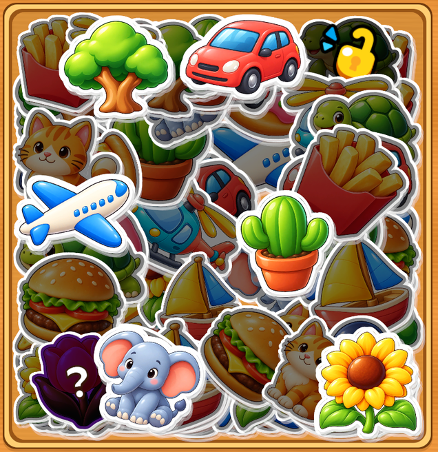

# Reference style sample

2026-10-25 size/rule update: **Board Sticker Size Multiplier = 0.75** on all four samples. Board images and alpha geometry are 25% smaller than the dense-layout baseline; album targets and buffer sticker sizes are unchanged. Dense regeneration reapplies this multiplier after packing, and special reveals remain validated. The buffer now loses at **4/4 or 5/5 occupied slots**, after automatic transfers resolve; the lose modal waits for the last sticker to finish sticking. Earlier coverage percentages/screenshots below describe the larger baseline. [Current board size](Screenshots/Board75.png) · [Full-tray lose proof](Screenshots/FullBufferLose.png).

The current samples are dense, irregular piles: **32 / 40 / 48 / 64 sticker instances** and **8 / 10 / 12 / 16 albums**. The existing 16 illustrations are reused across additional sets. Categories are mixed within every tray; placement has no category rows or fixed lattice. Angles, sizes, layer order and positions use a serialized seed. Covered darkness remains 0.68 and clears immediately when uncovered.

In each sample LevelDefinition, change **Generated Sticker Count** (a multiple of four) and **Layout Seed**, then use **Tools > Sticker Category Game > Fill Current Scene Trays with Dense Sticker Piles** with SampleStickerLevel open. This rebuilds the four samples' pieces, albums, overlaps and saved traces. It stages and replays every layout to Win before committing any asset. Prior YAML is backed up in ignored `UserSettings/StickyPeerSortBeforeDenseTrayFill/<scene name>`. The main scene's ten authored layouts are retained. The Reference Style generator also uses the dense pass for new samples and retains existing sample assets.

Album sizing follow-up: themed cards now use height 344 with a 224-unit content area. For the 2×2 cards, target Images increased from 121×72 to 133×108; both flat silhouettes and landed artwork use the same bounds. Header/count pills move toward the edges to free up the paper area. Inspected the two landed FOOD stickers in Play Mode; three focused landing/transition tests passed (job `4a13636dfa784cb88761e1fd9f618220`). [Updated album close-up](Screenshots/AlbumTargets.png).

Open `Assets/_Game/Scenes/SampleStickerLevel.unity`, then Play. Use **Tools > Sticker Category Game > Level Preview** to switch between all four samples; **Play Selected** starts the selected example directly. **Tools > Sticker Category Game > Reference Style > Generate Sample Scene and Four Levels** regenerates the view and prefabs. Existing sample level assets are retained so Inspector layout edits survive regeneration. The main scene and its ten levels are not rebuilt.

## Data and composition

All coordinates are logical units on the existing 1080×1920 portrait reference. The screen-space Canvas uses Scale With Screen Size, match 0.5, safe-area anchors and a uniformly fitted 1080×1920 layout. The background fills the whole viewport. `PortraitSafeArea` refits if screen dimensions or safe insets change. Tall phones keep additional wood margin; compact phones uniformly reduce the composition rather than stretching artwork. Live notches and device performance still need physical-device checks.

| Independent level asset under `Assets/_Game/ReferenceStyle/Data/Levels` | Composition | Sticker/album/buffer data | Reference comparison |
| --- | --- | --- | --- |
| `Level_05_Grid4.asset` | Four 430×394 trays, centers (±230, ±210). | 32 pieces, 8 sets; three active albums; four waiting slots. | Reference 01 establishes the 2×2 tray rhythm. [Rendered sample](Screenshots/Dense32.png). |
| `Level_12_Rows2.asset` | Two 890×380 horizontal trays at y ±210. | 40 pieces, 10 sets; linked PLANTS pair; four waiting slots. | Reference 04 establishes broad rows. [Rendered sample](Screenshots/Dense40.png). |
| `Level_19_Mixed3.asset` | Two 430×380 upper trays, one 890×390 lower tray. | 48 pieces, 12 sets; frozen sticker requires two ice-breaking taps; four waiting slots. | Reference 06 establishes the mixed-width composition. [Rendered sample](Screenshots/Dense48.png). |
| `Level_62_Pile1.asset` | One 780×810 central compartment. | 64 pieces, 16 sets; five waiting slots; FOOD key lock and partially covered Mystery. | Reference 03 establishes the single pile and key/mystery hierarchy. [Rendered sample](Screenshots/Dense64.png). |

These are original compositional demos, not extracted original levels. Their identities, positions, rotations, order, category references, target definitions, obstacles, buffer sizes and difficulty text are serialized in separate LevelDefinition assets. All use the existing alpha overlap rules, ordered flight commits, category transitions, Undo, loss and boosters. Level numbers label the examples; they do not imply equivalent difficulty or original puzzle solutions.

`DenseLevelContent` creates exact target groups and mixes identities across compartments. `DenseStickerLayout` uses randomized candidate poses and a coverage score sampled against actual sticker alpha, favoring uncovered well edges. Transparent PNG padding may extend outside the well; visible artwork stays inside its rim. A separate flat-model plan supplies a legal removal order with varied active categories; linked partners and frozen taps are scheduled consistently, then the entire trace is replayed through the actual packed geometry. Positions and categories are not assigned by that removal order. Initial measured well coverage: Grid4 79–84%, Rows2 87%, Mixed3 86–89%, Pile1 96%; this samples the well inset by 24 logical units and excludes the wooden rim.

## Reusable view assets

Prefabs are under `Assets/_Game/ReferenceStyle/Prefabs`:

- `LevelHeader.prefab`: navy/gold level and currency capsules, minimal settings button.
- `CategoryAlbumCard.prefab`: card shell used by the existing `GameplayUI.CreateCategory` / `CategoryCardPresentation` adapter. The adapter binds independent categories, 2×2 targets and count pills at runtime.
- `BufferSlot.prefab`: detached beveled wooden recess; centered collected image supplied by the existing buffer adapter.
- `StickerPiece.prefab`: existing StickerView API, arbitrary alpha shapes, shared TMP presets and soft shadow; artwork stays unwarped.
- `StickerTray.prefab`: reusable beveled compartment, inset wood and short shadow; StickerTrayView binds position/size/rotation from data.
- `StickerBoard.prefab`: logical board root; GameplayUI binds trays and sorted StickerViews from the level.
- `StickerLevelView.prefab`: complete Canvas, HUD, view bindings, modal, safe-area adapter and references to the reusable pieces. Add the existing GameController composition root, balance/audio assets and levels when using it in another scene.

This integrates with the existing Data → Core/Services → Gameplay → Runtime architecture. No second puzzle controller, Input System migration or Addressables dependency is introduced. Old Input Manager / StandaloneInputModule and TextMeshPro remain in use. Theme changes are opt-in through the sample ReferenceTheme; the main UI retains its current theme.

## Artwork replacement

The supplied ZIP has no sticker assets. The project already has representative cartoon PNGs with cream die-cut rims and illustrated highlights, so the sample reuses them instead of generating basic shapes or copying reference art. Sample StickerDefinition assets are independent clones under `ReferenceStyle/Data/Stickers`; the source definitions are untouched. Assign Texture or Sprite there to replace an individual motif, then bake its alpha mask in the Inspector and validate the level. Texture still takes precedence over Sprite.

Flat gold/cream album silhouettes are generated from the artwork's alpha into `ReferenceStyle/Art/*_silhouette.png`, referenced by `StickerDefinition.targetSilhouette`. They disappear when the real artwork lands. To regenerate one after replacing art, remove that generated silhouette PNG and its matching sample definition's silhouette reference, then use the Generate menu; existing definitions are re-baked. The HoneyWood texture is original procedural editor output. No Google Play PNG is loaded by the game. An atlas can later replace artwork through Sprite assignments; verify geometry/mask behavior after any atlas pipeline change.

## Visual states and rendering

Front/selectable stickers use full artwork color. Covered stickers have the existing alpha-shaped black veil beneath readable special symbols; they reject input with shake/red feedback. Picking up uses press/peel/pop, eased movement, rotation settling and a slightly elevated short flight shadow. Slotted/matched stickers use their actual texture in the exact target slot. Locked stickers show dim art plus a prominent lock; completing the key album plays key flight/open/flip before card exit. Frozen stickers use an icy tint and ICE badge. Linked pieces have a purple LINK badge. Mystery uses a dark violet face with a large white question mark and flips when uncovered. Main-scene visual settings are preserved.

The largest sample has 64 pieces sharing the existing 16 artwork textures, three active albums and five waiting slots. Decorative images have raycasts disabled; shared UI/TMP materials are reused. The wood is static; no bloom, 3D camera, animated grain or extra particle system was added. A 1080×1920 Pile1 Editor capture reported 104 batches / 3,696 triangles; this is a diagnostic observation, not Android profiling. Flights still use the existing short-lived ghosts; device profiling should guide pooling and artwork atlasing. Reference images remain only in ignored Temp and are not game assets.

The sample controller uses `StickyPeerSort.ReferenceStyle.Save.v1`; main progress continues to use `StickyPeerSort.Save.v1`. Sample rewards are zero. Sound preference remains shared with the main game.

## Reference links

[01 / Grid4](https://play-lh.googleusercontent.com/dNfpbIjD46hLKpPssAvC1JsAdsNDOIk3olgpXo8ixR-iT8DHLHh8W_26q9suswwaAYjjm1UzLjqK2KpzuSuHitw=w950-h950), [04 / Rows2](https://play-lh.googleusercontent.com/IllDybDoXeFYgY8Z1vqvtCEtER04HCQwlYJgGhQky0dq4zbZ_BhH39CtS7AcfMk9mekToJfbXWdd4zAQuWbF=w950-h950), [06 / Mixed3](https://play-lh.googleusercontent.com/iwGfBWrLIja5Pz-1zg9hczacrCWzEG7BY1kZFNJhAudegRtThXQetsZQ5R168tVhfBBXUnilBlvLWYrPd--6EQ=w950-h950), [03 / Pile1](https://play-lh.googleusercontent.com/b4zUKfhmvLG_GIQEvBOlCwKgdg3NZF5Ph8OGw4xoW1iq35bkIfuoIL_P9EbpJIZnArHRofTYTRFyHdm6ZluB=w950-h950).
