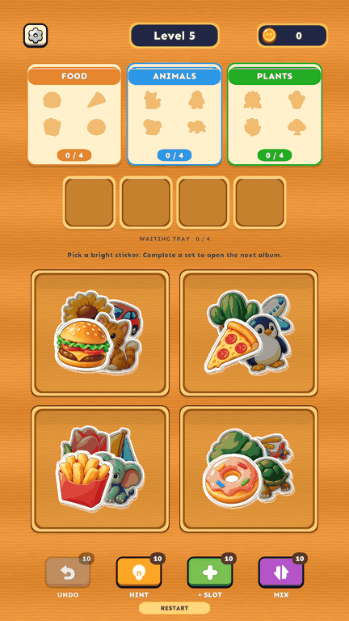

# Sticker peel / reverse-stick animation

The GIF captures fixed poses of the actual Unity curl renderer so screenshot encoding cannot advance the unscaled animation between samples. It illustrates the shape/motion; gameplay uses the configured short durations below.

The movement presenter now uses three visual phases: lift/curl at the original position, jump while folded, then reverse the same curl onto the destination. The curved section exposes a cream paper underside with gentle shading. This is a projected cylindrical page fold on the Image mesh, not a flat scale/flip and not a rectangular card replacing the sticker.

`StickerCurlMesh` tessellates the sprite's fitted Image rectangle into 32×4 quads. It keeps original texture UVs and alpha, so irregular die-cut contours and transparent holes follow the fold. `UI/StickerCurl` uses those UVs for artwork/alpha and UV1 for underside/shading. One material asset is shared; the renderer supplies each sticker's own texture. The component only exists on the flight ghost, not every board sticker. It introduces no physics or 3D camera.

`StickerPeelPresentation` animates the fold; `MovePresentationPlayer` keeps ownership of movement, live target tracking, ordered commits and cancellation. Normal taps still start concurrent flights. Each arriving sticker waits its turn while folded, tracks the live target during flattening, then commits the exact target/buffer slot and plays landing audio. Category completion and removal still follow the visible final sticker. Board→album, board→buffer and buffer→album use the same sequence. Restart/level load cancels the runner and removes the ghost.

Configuration in the existing main `Assets/_Game/Data/Balance.asset` and sample `Assets/_Game/ReferenceStyle/Data/ReferenceBalance.asset`:

| Inspector setting | Configured value | Purpose |
| --- | --- | --- |
| Page Peel | On | Enable the new fold. Off retains the ordinary flight. |
| Page Peel Material | `Assets/_Game/UI/StickerPagePeel.mat` | Included UI shader and cream underside. |
| Peel Duration | 0.16 seconds | Curl before leaving the source. |
| Travel Duration | 0.24 seconds | Existing eased jump. |
| Stick Duration | 0.14 seconds | Reverse curl at the live destination. |
| Flight Arc / Flight Pop | Existing settings | Jump arc and pickup bounce. |

**Tools > Sticker Category Game > Enable Sticker Page Peel** recreates the shared material if missing and configures both balance assets. It does not rebuild either scene or change rules/artwork. Placeholder labels fade out while folded and return as the sticker flattens; production artwork stays on the deforming mesh.

Verification covers curved front/underside geometry, bounded UVs, flat restoration, actual shader import, source peel before travel, delayed slot commit until flattening, moving destinations, cancellation, concurrent commit order, irregular artwork, overflow and all original/sample level traces. Device rendering/performance still requires an Android build.

2026-10-24: **54 EditMode passed** (job `d0c80ee680e54d658b2c83baa9275c26`), **22 PlayMode passed** (job `e90a3272befe45ab81dbdd373057f9b0`). Shader import reports supported, no shader messages, no C# compilation errors. Inspected actual cream underside and reverse fold in the live sample Game View. Preview captures use temporary slower timings; configured gameplay durations remain 0.16 + 0.24 + 0.14 seconds.
